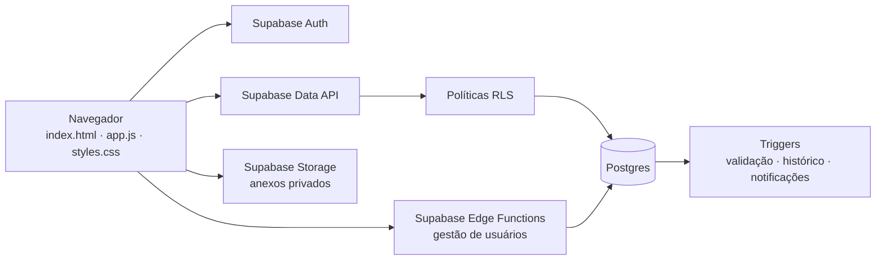

# Hekp Gesk — Help Desk

Aplicação web para abertura e acompanhamento de chamados, aprovação de orçamentos e reserva de salas. A autenticação e os dados compartilhados usam Supabase; as regras de acesso são aplicadas no banco.

## Arquitetura

A interface é uma aplicação de página única (SPA), sem framework de frontend nem etapa de compilação. O navegador carrega os arquivos estáticos e usa `supabase-js` para autenticação e acesso aos dados.



- `index.html` carrega a aplicação; `app.js` controla as telas, as rotas pelo hash (por exemplo, `#/dashboard`) e as chamadas ao Supabase; `styles.css` contém o visual.
- O Supabase Auth gerencia contas e sessões. O Postgres guarda perfis, chamados, comentários, eventos, notificações, anexos e reservas.
- RLS aplica permissões por perfil e por chamado. As verificações na interface organizam o que aparece; a segurança não depende de esconder botões.
- Triggers validam transições, registram mudanças no histórico e geram notificações. Orçamentos e outros arquivos ficam em um bucket privado.
- Edge Functions fazem operações administrativas de conta no servidor, sem expor uma chave privilegiada no navegador.

## Configurar o Supabase

1. Crie um projeto Supabase.
2. No SQL Editor, execute [`supabase-schema.sql`](supabase-schema.sql).
3. Em **Authentication → Users**, crie a conta inicial de administração. Desative o cadastro público.
4. Consulte os escritórios criados pelo esquema:

   ```sql
   select id, name from public.offices order by name;
   ```

5. Crie o perfil de administração, substituindo os UUIDs:

   ```sql
   insert into public.profiles (id, name, role, office_id)
   values ('UUID_DO_USUARIO_AUTH', 'Nome do administrador', 'admin', 'UUID_DO_ESCRITORIO');
   ```

6. Em **Project Settings → API**, copie a URL do projeto e a chave **publishable**. Preencha `url` e `publishableKey` em `config.js`. Não coloque chaves `secret` ou `service_role` no navegador.

### Migrações

Execute no SQL Editor do mesmo projeto, nesta ordem:

1. [`supabase/room-reservations.sql`](supabase/room-reservations.sql) — salas, reservas e bloqueio de horários sobrepostos. É opcional se o módulo de salas não for usado.
2. [`supabase/user-permissions.sql`](supabase/user-permissions.sql) — políticas e permissões dos perfis atuais.
3. [`supabase/ticket-workflow.sql`](supabase/ticket-workflow.sql) — etapas do fluxo, anexos privados, notificações, validações e políticas do processo de orçamento.
4. [`supabase/ticket-assignment.sql`](supabase/ticket-assignment.sql) — permite escolher o primeiro responsável ao abrir o chamado.
5. [`supabase/finance-track-all-tickets.sql`](supabase/finance-track-all-tickets.sql) — permite que o Financeiro leia todos os chamados até a conclusão; não amplia as permissões de edição.
6. [`supabase/ticket-expenses.sql`](supabase/ticket-expenses.sql) — cria o registro protegido do valor efetivamente pago e as permissões para o Financeiro responsável.

Em um projeto já em uso, confira quais migrações foram aplicadas antes de executar arquivos novamente. O arquivo de reservas pode ser reaplicado sem apagar reservas existentes.

### Funções de usuário

Para cadastrar usuários pelo menu **Equipe**, publique a Edge Function `create-user`:

1. Em **Edge Functions → Deploy a new function → Via Editor**, crie uma função chamada `create-user`.
2. Copie `supabase/functions/create-user/index.ts`, mantenha a verificação JWT ativa e publique.

Publique também as funções necessárias:

- `update-user`, com o código de `supabase/functions/update-user/index.ts`, para alterar perfis pelo menu **Equipe**.
- `delete-user`, com o código de `supabase/functions/delete-user/index.ts`, se quiser habilitar a exclusão de contas. Antes, execute [`supabase/account-deletion.sql`](supabase/account-deletion.sql).

As funções verificam o perfil da pessoa que fez a chamada. O Supabase mantém as credenciais administrativas no servidor. Consulte a [publicação de Edge Functions pelo Dashboard](https://supabase.com/docs/guides/functions/quickstart-dashboard) e a [segurança de Edge Functions](https://supabase.com/docs/guides/functions/auth).

## Perfis e permissões

Os valores de perfil no banco são `colaborador`, `financeiro`, `coordenador` e `admin`. A tela mostra `admin` como **Administração**. Não existe um perfil separado chamado “Atendente”.

- **Colaborador:** abre chamados para seu escritório e consulta os chamados que abriu ou que foram atribuídos a ele.
- **Financeiro:** consulta todos os chamados, comentários, histórico e anexos. Pode aprovar ou rejeitar apenas os orçamentos atribuídos a ele na etapa financeira; não pode mudar responsáveis nem o valor enviado. Depois da aprovação, registra ou corrige o gasto realizado do chamado que está atribuído a ele.
- **Coordenador:** pode administrar chamados e reservas, alterar responsáveis e perfis da equipe, além de gerenciar salas.
- **Administração:** tem as permissões completas do sistema.

A aplicação não permite criar outro perfil `admin` pelo formulário. Para dar administração a uma conta, isso precisa ser feito por um administrador autorizado no Supabase.

## Fluxo do chamado e do orçamento

O sistema mantém dois conceitos separados:

- `status` é o estado apresentado no chamado: `aberto`, `andamento`, `aguardando`, `resolvido` ou `encerrado`.
- `workflow_step` representa a etapa do processo: `triagem`, `orcamento`, `financeiro`, `execucao` ou `resolvido`.

O fluxo padrão é:

1. Administração ou coordenação define a pessoa responsável pelo acompanhamento e a pessoa do Financeiro.
2. A pessoa responsável inicia o contato e obtém o orçamento.
3. O orçamento e o valor são registrados, e o chamado segue para o Financeiro.
4. O Financeiro aprova ou rejeita. Uma rejeição exige observação; a decisão fica no histórico e o chamado volta à pessoa responsável.
5. Depois da execução, a pessoa responsável confirma a conclusão. Essa ação conclui a etapa e marca o chamado como resolvido.
6. O Financeiro responsável registra o valor pago e a data quando o pagamento estiver confirmado. Esse dado alimenta a área **Gastos dos chamados**, que resume os totais por categoria e mostra o valor por chamado.

Administração e coordenação também podem ajustar manualmente o status no chamado, exceto **Resolvido**, que é definido pela ação de conclusão do fluxo. Como status e etapa são campos separados, prefira as ações do fluxo para avançar ou concluir o processo.

### Relatório de gastos do Financeiro

O menu **Gastos dos chamados** é exclusivo do perfil Financeiro. O relatório soma valores efetivamente pagos informados pelo Financeiro; o orçamento aprovado aparece em coluna separada para comparação e nunca é tratado como pagamento. Chamados aprovados sem gasto registrado ficam como **Não informado** e entram na contagem de pendentes. Cada Financeiro pode registrar ou atualizar o valor apenas para os chamados atribuídos a ele, após a aprovação e durante a execução ou depois da conclusão. RLS protege a tabela de gastos no banco, além das verificações da interface.

As notificações são internas ao app. O painel busca as não lidas e atualiza a lista periodicamente enquanto a sessão está aberta. Ao abrir uma notificação, o sistema salva `read_at` para aquela pessoa; a leitura não apaga o histórico do banco nem oculta a notificação para outros destinatários. O sistema não envia e-mail nem integra WhatsApp.

Os anexos ficam em bucket privado do Supabase Storage. Os links para visualização expiram após um minuto.

## Reservas de salas

Depois de executar `supabase/room-reservations.sql`, entre com um perfil de administração ou coordenação e cadastre as salas em **Reservas de salas**.

- Os horários usam o fuso de Brasília (`America/Sao_Paulo`) e aceitam reuniões de 30, 60, 90 ou 120 minutos, entre 08:00 e 18:00.
- Todas as pessoas autenticadas podem consultar as reuniões. Cada uma pode editar ou cancelar as próprias reservas; administração e coordenação podem gerenciar todas.
- O banco impede reservas sobrepostas para a mesma sala. Cancelar uma reserva libera o horário sem apagar o histórico.

Se o app for publicado antes dessa migração, os chamados continuam disponíveis e o módulo de reservas exibe um aviso de configuração pendente.

## Publicar e executar

O frontend é composto por arquivos estáticos e pode ser servido por uma hospedagem HTTPS. Neste projeto, a publicação está configurada no Cloudflare Workers a partir do repositório; atualizações na branch principal seguem o deploy automático configurado.

Para desenvolvimento, sirva a pasta por um servidor web estático. Mantenha `index.html`, `app.js`, `styles.css` e `config.js` acessíveis no mesmo diretório. O navegador carrega `supabase-js` pela CDN jsDelivr, então precisa de acesso à internet.

Para habilitar redefinição de senha, em **Authentication → URL Configuration → Redirect URLs**, permita o endereço do app com `?auth-recovery=1`, por exemplo `https://seu-dominio.com/?auth-recovery=1`. O endereço cadastrado deve corresponder ao domínio em que o app está aberto.

## Limites atuais

O projeto é um MVP: não define SLA, não envia notificações por e-mail ou WhatsApp e não inclui contas ou chamados de demonstração. Antes de usar dados sensíveis, revise as políticas RLS, os backups e os procedimentos operacionais do projeto.
